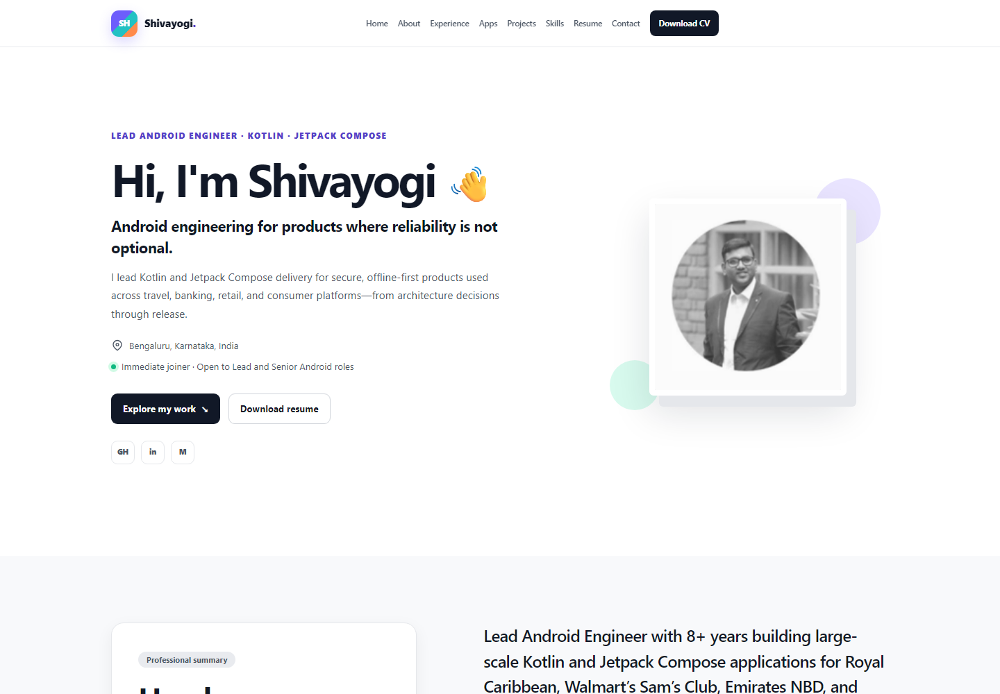

# Shivayogi Hiremath — Professional Portfolio

A production-focused portfolio for Shivayogi Hiremath, Lead Android Engineer and Mobile Architect. The light-only site presents verified experience, public links for seven worked-on applications, two product case studies, a supplied profile portrait, and supplied resume assets.

[View the live website](https://shivayogih.github.io/shivayogi-portfolio/)



## Project status

Portfolio v1 is live at [shivayogih.github.io/shivayogi-portfolio](https://shivayogih.github.io/shivayogi-portfolio/). CI validates every pull request, and the GitHub Pages workflow publishes the reviewed static export from `main`.

## Technology

- Next.js 16 with the App Router and React Server Components
- React 19 and strict TypeScript
- Tailwind CSS 4 with a token-based custom visual system
- Static export for GitHub Pages under `/shivayogi-portfolio/`
- Vitest, Testing Library, and jest-dom
- Supplied concise resume and detailed CV assets with structural PDF validation
- Separate GitHub-backed `/admin/` publishing workspace for content and media updates
- GitHub Actions CI and official GitHub Pages deployment actions

## Local setup

Requirements:

- Node.js 22.23.1 LTS
- npm 10 or newer

```bash
npm ci
npm run dev
```

Open [http://localhost:3000](http://localhost:3000). Local development intentionally runs without the GitHub Pages base path.

## Commands

| Command | Purpose |
|---|---|
| `npm run dev` | Start the local Next.js development server |
| `npm run lint` | Run ESLint with zero warnings allowed |
| `npm run typecheck` | Run strict TypeScript validation |
| `npm run test` | Run component and content-contract tests |
| `npm run verify:resume` | Validate the supplied resume and detailed CV structure and page counts |
| `npm run build` | Create the static site in `out/` |
| `npm run verify:export` | Validate exported routes, assets, and privacy constraints |
| `npm run qa:browser` | Run browser, responsive, keyboard, and WCAG checks in Microsoft Edge |
| `npm run qa:lighthouse` | Run the desktop Lighthouse release thresholds |
| `npm run verify` | Run the complete local validation pipeline |

## Architecture

Personal content is isolated in [`src/content/portfolio.json`](src/content/portfolio.json), then checked against the TypeScript model in [`src/content/portfolio.ts`](src/content/portfolio.ts). Server-rendered presentation components consume that model, while focused React client components handle the admin editor, mobile navigation, and clipboard feedback. Static export configuration applies the repository base path only in GitHub Actions so local navigation remains simple.

See [`docs/architecture.md`](docs/architecture.md) for the full structure and runtime boundaries.

## Updating content

Use the live `/admin/` page for routine updates. Create a fine-grained GitHub token limited to this repository with **Contents: read and write**, paste it into the session-only token field, load the latest content, edit the values or replace media, confirm, and publish. The token is never stored by the site. Localhost and branch previews are intentionally view-only.

For code review or recovery:

1. Edit `src/content/portfolio.json` directly.
2. Replace resume or profile assets only with reviewed files supplied by Shivayogi.
3. Run `npm run verify`.
4. Review the website, worked-app links, admin page, and both PDF downloads before committing.

Do not add unverified employment metrics, social profiles, public project links, or confidential client material. See [`docs/content-guide.md`](docs/content-guide.md).

## Resume

The HTML resume is available at `/resume/`. The concise two-page resume is stored at `public/Shivayogi-Hiremath-Resume.pdf`, and the detailed three-page CV is stored at `public/Shivayogi-Hiremath-Detailed-CV.pdf`. Both files were supplied by Shivayogi and are validated during CI.

## Deployment

Merges to `main` trigger `.github/workflows/deploy-pages.yml`, which validates the source, builds the static export with the repository base path, uploads `out/`, and deploys through the official GitHub Pages environment.

See [`docs/deployment.md`](docs/deployment.md) for setup, verification, and troubleshooting.

## Contributing and security

- [Contributing guide](CONTRIBUTING.md)
- [Security policy](SECURITY.md)
- [Code of conduct](CODE_OF_CONDUCT.md)

## Licence and content rights

The source code is licensed under the [MIT Licence](LICENSE). Personal written content, resume content, profile assets, and Shivayogi Hiremath’s name and branding are not granted for reuse by the source-code licence.
